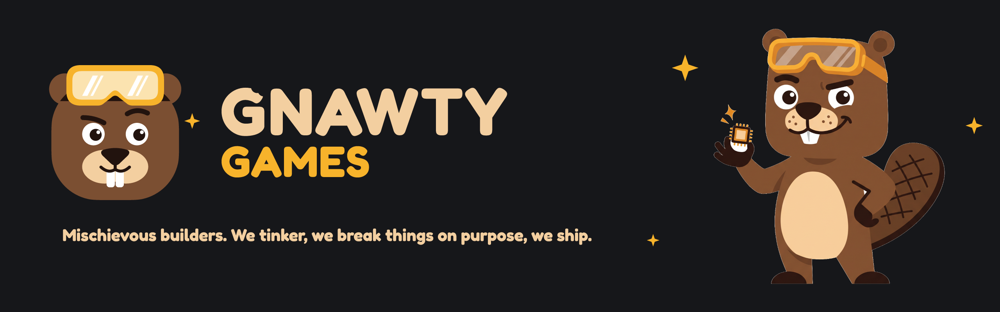
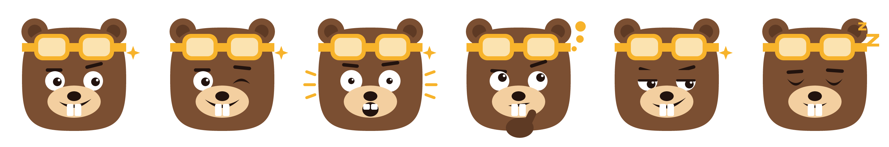
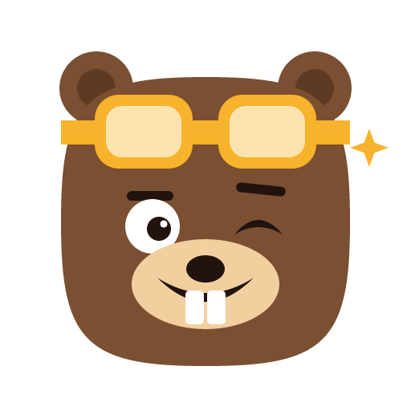

  

<h3 align="center">Two brothers, one lab, a lot of things that go <i>boom</i>.</h3>

  
  
  
  

---

### 🧪 What we do

We make games that each have one twist you can see from across the room. We tinker, break things on purpose, and ship. The patch notes read like a lab log: *Tested. Exploded. Fixed.*

- **Roblox first.** Small, fast experiences you can jump into with friends.
- **Unity and Unreal next.** Bigger builds for PC once the lab is ready.

### 🦫 Meet the lab rat (well, beaver)

Our mascot is a young beaver who always presses the button first. Goggles up, curiosity on.

  

### 🔧 In the workshop

| Repo | What's in it |
|---|---|
| `template-roblox` | Our Roblox starter: Rojo, Wally, Selene, StyLua, Lune tests |
| `brand` | Mascot, logo, palette and every export, built from scripts |

---

   
  Made with goggles on by Gnawty Games · <a href="https://gnawtygames.com">gnawtygames.com</a>

